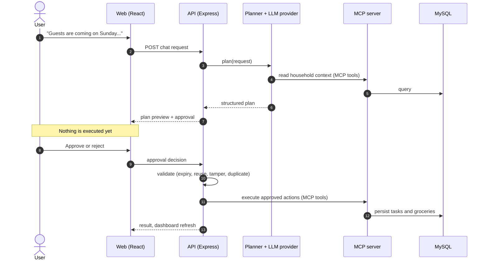

<div align="center">



<br>


**An AI agent that turns household requests into reviewable, structured plans
and executes approved actions through validated tools.**

[Story](#the-problem) ·
[Architecture](#architecture) ·
[Quick start](#quick-start) ·
[Security](#security-model) ·
[Status](#verification-status) ·
[Roadmap](#roadmap)

</div>

> [!WARNING]
> **Local development / demo build.** There is no user authentication, there is
> a single seeded household, and all seed data is fake. **Do not expose it
> publicly.** HomeFlow AI is **not connected to a live Alexa+ system**.

Built for the **Amazon Build, Ship, Shape — Developer Hackathon 2026**
(intended primary track: **Alexa+**, see [eligibility caveat](#alexa-track-and-eligibility)).

---

## The problem

Household logistics are scattered across chat threads, memory, and half-written
lists. A voice or chat assistant that acts on that mess without asking is risky;
one that only answers questions is not useful.

HomeFlow AI takes a middle path: the model **proposes**, the backend
**validates**, and a person **approves** before anything is written.

> "Guests are coming on Sunday. Help me prepare."

HomeFlow reads household context (preferences, members, open tasks, grocery
list), proposes a plan of tasks and groceries, shows it for review, and
executes it through MCP tools only after approval.

## How it works

**Request → household context → structured plan → human review →
approve / reject → validated MCP execution → persisted household state**



The diagram reflects the flow described in the project documentation. Exact
route names and tool names live in [`docs/`](docs/); confirm them there.

## Features

Implemented per the project documentation (see [Verification status](#verification-status)
for what has and has not been tested):

- Chat → structured plan → **preview → approve / reject** → execution → persisted dashboard.
- Household context (preferences, members, open tasks, grocery list) read via MCP.
- Task planning and grocery list with duplicate-safe updates.
- Self-hosted **MCP server** using the official TypeScript SDK, Streamable HTTP, bearer-token auth.
- Google Gemini is the only configured application runtime provider. A deterministic **mock** provider remains available for isolated automated tests.
- Idempotent, server-validated approvals: expiry, no reuse, no double execution.

**Not included:** voice, payments, smart-home control, multi-user permissions, authentication.

## Architecture

| Layer | Technology | Location |
| --- | --- | --- |
| Frontend | React, Vite, TypeScript, Tailwind v4 | `apps/web` |
| API | Node.js, Express (`/api/v1`), orchestration, approvals | `apps/api` |
| Tool server | MCP over Streamable HTTP, 3 tools | `apps/mcp-server` |
| Agent | LLM providers, planner loop, MCP client | `packages/agent` |
| Persistence | Prisma 7, MySQL 8+ / MariaDB 10.11+ | `packages/database` |
| Contracts | Zod schemas, DTOs, `DomainError` | `packages/shared` |
| Tests | Vitest, shared global setup for the test DB | `tests/support` |

Key design decisions and trade-offs:

- **The model never writes state directly.** Writes happen only through MCP tools,
  after approval. This keeps the trust boundary narrow and auditable.
- **Same loop for mock and real models.** The mock provider uses the same
  tool-calling loop, MCP server, and approval flow, so the demo exercises the
  real architecture.
- **Shared Zod schemas** define validation boundaries once for web, API, and tools.
- **Short-lived MCP session per call.** Simple and robust, slightly slower.
  Session reuse is a roadmap item.
- **Single-turn planning.** No conversation memory in the planner yet.

Full detail: [docs/ARCHITECTURE.md](docs/ARCHITECTURE.md),
[docs/DATABASE_DESIGN.md](docs/DATABASE_DESIGN.md), and the rest of [`docs/`](docs/).

## Security model

- Approvals are validated **server-side**: they expire, cannot be reused, and
  cannot trigger duplicate execution. The test suite covers repeat and tamper cases.
- The MCP server requires a bearer token (`MCP_AUTH_TOKEN`, at least 16 characters).
- CORS is restricted via `CORS_ORIGINS`.
- **Boundaries and limits:**
  - No user authentication or authorization; a single household.
  - Not safe for public production deployment as it stands.
  - A crash between approval and execution leaves the approval `APPROVED`;
    there is no recovery job yet.
  - `npm audit` (checked 14 Oct 2026) reports high-severity advisories that are
    **transitive dependencies of Prisma 7** (`mariadb` connector inside
    `@prisma/adapter-mariadb`, `deepmerge-ts` / `mysql2` in Prisma tooling) with
    no non-breaking fix available. The MariaDB-connector advisories concern
    credential exposure to a man-in-the-middle on unencrypted connections.
    Keep the database on loopback or private networking, or use TLS. Re-run
    `npm audit` and update Prisma before any public deployment.

## AI providers: mock vs Google Gemini

| | Mock (tests only) | Google Gemini |
| --- | --- | --- |
| Selected by | Direct test dependency injection | `AI_PROVIDER=gemini` |
| Credentials | None | `GEMINI_API_KEY` |
| Config | None | `GEMINI_API_KEY`, `GEMINI_MODEL` (default `gemini-3.5-flash-lite`) |
| Behavior | Deterministic test fixture only. **Not an LLM.** | Gemini function calling produces validated proposals; writes still require approval |
| Failures | n/a | Reported as `502 PROVIDER_ERROR`; **no silent fallback** to mock |
| Verification | Automated tests | Fake-client tests; live verification requires a configured API key |

To add a provider, implement `LlmProvider` in `packages/agent/src/providers/types.ts`
and register it in `createProvider`.

## Quick start

Written for Fedora Linux. Review `scripts/fedora-setup.sh` before running it; it uses `sudo`.

```bash
git clone <your-repo-url> homeflow-ai && cd homeflow-ai
./scripts/fedora-setup.sh                 # dnf: git, nodejs, npm, podman
cp .env.example .env
sed -i "s/^MCP_AUTH_TOKEN=.*/MCP_AUTH_TOKEN=$(openssl rand -hex 32)/" .env
podman compose up -d                      # or: docker compose up -d  (MySQL 8.4 on 127.0.0.1:3306)
npm install                               # also runs `prisma generate`
npm run db:migrate:deploy                 # applies committed migrations
npm run db:seed                           # FAKE demo household
npm run dev                               # web :5173, api :4000, mcp :4100
```

Open <http://localhost:5173> and click the example prompt. In a second terminal,
run `./scripts/smoke-test.sh` to check the running stack.

Already running MySQL or MariaDB? Skip compose. Create a database and user
matching `DATABASE_URL`, plus a `homeflow_test` database for tests.

### Prerequisites

- Node.js ≥ 22.12 and npm ≥ 10
- MySQL 8+ or MariaDB 10.11+
- git
- Podman or Docker (optional, for the bundled database)

### Environment variables

Copy `.env.example` to `.env`. **Never commit `.env`**, credentials, or database dumps.
At minimum set `MCP_AUTH_TOKEN`, and set `DATABASE_URL` / `TEST_DATABASE_URL` if you
are not using the compose defaults. The full table is in
[docs/DEPLOYMENT.md](docs/DEPLOYMENT.md).

## Development commands

| Command | What it does |
| --- | --- |
| `npm run dev` | web + API + MCP server with reload |
| `npm run build` | bundle API and MCP (`tsup`), build web (`vite`) |
| `npm run typecheck` | `tsc --noEmit` in every workspace |
| `npm run lint` / `npm run format` | ESLint / Prettier |
| `npm test` | Vitest across all workspaces. **Destructive:** drops and recreates `TEST_DATABASE_URL`, which must end in `_test` |
| `npm run db:generate` | `prisma generate` (also runs on `npm install`) |
| `npm run db:migrate` | `prisma migrate dev` (interactive, creates migrations) |
| `npm run db:migrate:deploy` | apply committed migrations |
| `npm run db:seed` | insert fake demo data (idempotent) |
| `npm run db:reset` | **Destructive:** drop everything, re-apply migrations |
| `npm run start -w @homeflow/api` / `@homeflow/mcp-server` | run the built bundles |

> [!CAUTION]
> `npm test` and `npm run db:reset` delete data. Point `TEST_DATABASE_URL` at a
> throwaway database whose name ends in `_test`, never at data you care about.

## Troubleshooting

| Symptom | Fix |
| --- | --- |
| `Cannot connect to the test database server` | Start MySQL (`podman compose up -d`), check `TEST_DATABASE_URL` |
| `RSA public key is not available client side` | Use a loopback host in `DATABASE_URL`, or add `?allowPublicKeyRetrieval=true` (loopback hosts get this automatically) |
| `DATABASE_URL is not set` / API exits at start | `.env` is missing in the repo root |
| `MCP_AUTH_TOKEN must be at least 16 characters` | Set a longer token in `.env` |
| UI shows "Cannot reach the HomeFlow API" | Start `npm run dev`; check `VITE_API_BASE_URL` and `CORS_ORIGINS` |
| Header shows MCP down / `502 UPSTREAM_ERROR` | MCP is not running, or the token does not match |
| `prisma generate` cannot download engines | Needs internet access to `binaries.prisma.sh` once |
| `No household found` | Run `npm run db:seed` |
| Port in use | Change `API_PORT` / `MCP_PORT` (and `MCP_URL`, `VITE_API_BASE_URL`) |
| `prisma migrate dev` reports drift on first run | See the caveat in [docs/DATABASE_DESIGN.md](docs/DATABASE_DESIGN.md#migration-strategy) |

## Alexa+ track and eligibility

**Chosen route:** a self-hosted MCP server over Streamable HTTP, plus a custom web
interface acting as the MCP-client-side experience. The API's MCP client calls
the server at runtime for every context read and every executed action.

- `@modelcontextprotocol/sdk` 1.32.1 supports protocol version **2025-11-25**
  (checked in its source). The team's research brief states the rules require
  2025-11-25 or later and Streamable HTTP.
- The brief says the rules also allow a web-based simulated Alexa+ experience,
  which has *different requirements*.
- **Eligibility is unconfirmed.** The team has not read the official rules text;
  it relied on the brief and third-party project READMEs. A custom web app does
  **not** automatically satisfy every Alexa+ requirement.
- **Open action:** read the official rules and FAQ and confirm whether this route
  is acceptable, and what the demo must show (a real Alexa+ client or Agent Skill
  versus the simulation path). Partner-only Amazon tools are not used.

## Verification status

Status verified **19 Oct 2026**.

**Verified** in the authoring sandbox (Node 22, MariaDB 10.11):

- typecheck and lint
- 49 automated tests: shared schemas, DB services, MCP tools over real Streamable HTTP,
  API (approval, rejection, expiry, repeat, tamper, CORS, validation), mock planner,
  and the Gemini provider with a fake client
- production builds of all three apps
- live Gemini planning with `gemini-3.5-flash-lite`, approval execution through MCP,
  persisted tasks/groceries, and rejection without database writes
- a manual run of the built API and MCP with curl: plan → approve → repeat approve,
  tasks 4 → 8, groceries deduplicated
- Vite dev server serving the app; CORS preflight

**Not verified:**

- MySQL 8.4 itself (only MariaDB was used)
- `prisma migrate dev` / `deploy` (the schema engine could not be downloaded in the sandbox;
  the initial migration SQL is hand-written)
- the UI in a real browser (builds and typechecks only)
- `docker compose` / Podman
- the GitHub Actions workflow
- any AWS deployment
- any real Alexa+ integration

## Roadmap

| Status | Item |
| --- | --- |
| Implemented | Gemini-backed plan → approve/reject → execute flow, MCP server, persisted dashboard, approval validation |
| In progress | Confirm Alexa+ eligibility and demo requirements |
| Planned | Verify migrations on MySQL 8.4 and Podman/Docker compose |
| Planned | Verify the UI in a real browser |
| Planned | Recovery job for approvals stuck in `APPROVED` after a crash |
| Planned | MCP session reuse |
| Planned | Multi-turn planner memory and richer household memory |
| Planned | Authentication, multi-user permissions, multiple households |
| Planned | Recurring task planning, voice integration |

## Repository layout

```text
apps/web          React + Vite + TS + Tailwind v4 (dashboard, chat, plan preview)
apps/api          Express API (/api/v1), orchestration, approvals
apps/mcp-server   MCP server (Streamable HTTP) and the 3 tools
packages/database Prisma 7 schema, migration, seed, DB services
packages/shared   Zod schemas, DTOs, DomainError
packages/agent    LLM providers, planner loop, MCP client
docs/             system design, architecture (Mermaid), DB, API, MCP, security, plan, deployment
tests/support     Vitest global setup (test DB) and helpers
```

Deviations from the suggested tree:
[docs/ARCHITECTURE.md](docs/ARCHITECTURE.md#structure-adjustments-vs-the-suggested-tree).

## Contributing

Proposed workflow for a four-person team (adopt or adjust; no formal process is
documented yet):

1. Branch from `main` per task: `feat/<area>-<short-name>`.
2. Run `npm run typecheck && npm run lint && npm test` before opening a pull request.
3. Require one teammate's review before merging.
4. Keep changes within one workspace where possible; changes to `packages/shared`
   schemas need a heads-up to everyone.
5. Never commit `.env`, credentials, or database dumps.

## License

MIT. See [LICENSE](LICENSE).