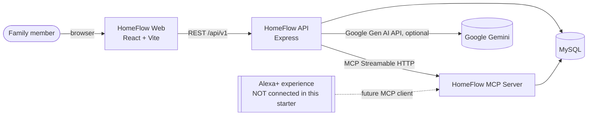
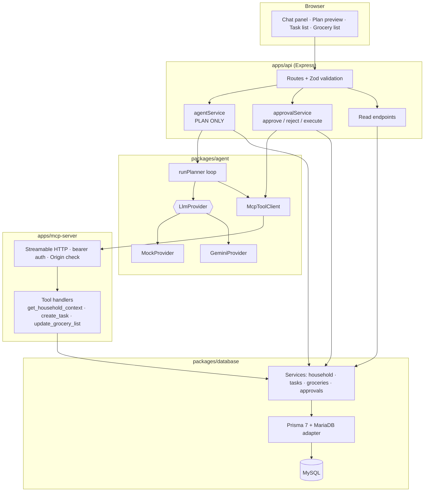
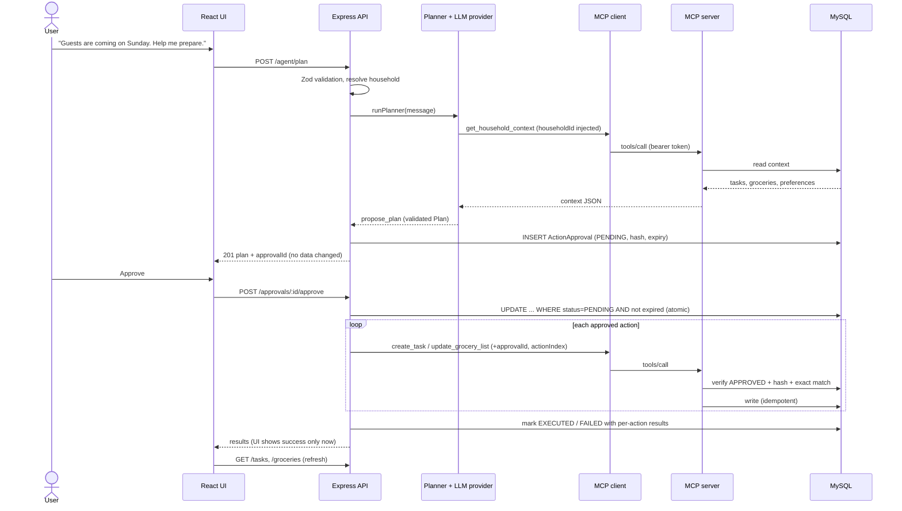
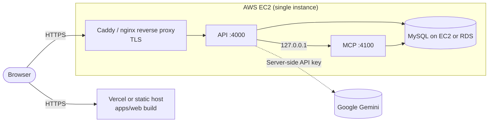

# Architecture

Diagrams are Mermaid (rendered by GitHub and most Markdown viewers).

## 1. System context

The dotted line is a **planned** integration path, not something this repository implements or tests.

## 2. Components

| Component                              | Responsibility                                                                                              | Must NOT do                                                                                   |
| -------------------------------------- | ----------------------------------------------------------------------------------------------------------- | --------------------------------------------------------------------------------------------- |
| **Express API**                        | Validation, CORS, rate limiting, error shaping, resolving the household, orchestrating plan/approve/reject. | Let the model or browser pick the household or run state-changing tools directly.             |
| **Agent orchestration** (`runPlanner`) | Tool-calling loop with the LLM; injects `householdId`; validates the proposed plan.                         | Expose write tools to the model.                                                              |
| **LLM provider**                       | Translate to/from the Google Gemini API (or the deterministic mock).                                         | Hold household data or fall back silently to mock.                                             |
| **MCP client** (`McpToolClient`)       | Calls MCP tools over Streamable HTTP with a bearer token.                                                   | Bypass the MCP server to write data.                                                          |
| **MCP server**                         | Exposes three explicit tools; validates input; verifies approvals for write tools.                          | Replace the API (no sessions, users, or UI logic); run arbitrary SQL or touch the filesystem. |
| **Tool handlers**                      | Parse input, verify the approval, call a database service, return structured JSON.                          | Contain business rules that belong in services.                                               |
| **Database services**                  | The only code that talks to Prisma; enforce idempotency, dedupe, atomic approval transitions.               | Know about HTTP or MCP.                                                                       |

## 3. Request sequence (plan, approve, execute)

## 4. Deployment (target, not yet exercised)

MCP stays on loopback unless a remote MCP client (e.g. a real Alexa+ integration) must reach it; then expose only `/mcp` over HTTPS with proper authentication. See [DEPLOYMENT.md](DEPLOYMENT.md).

## 5. Database ER diagram

See [DATABASE_DESIGN.md](DATABASE_DESIGN.md).

## Structure adjustments vs. the suggested tree

- `apps/api/src/controllers/` and `errors/` were dropped: handlers are small and live in `routes/index.ts`; the shared `DomainError` lives in `packages/shared`.
- `apps/mcp-server/src/services/` was dropped: tool handlers call `packages/database` services directly.
- DB services live in `packages/database/src/services` (shared by API and MCP) instead of `apps/*/services`.
- `packages/*` export TypeScript source directly; apps are bundled with `tsup`. There is no separate build step for packages.
- `apps/web` has no router (single page) and the `features/` folder holds the assistant state hook.
