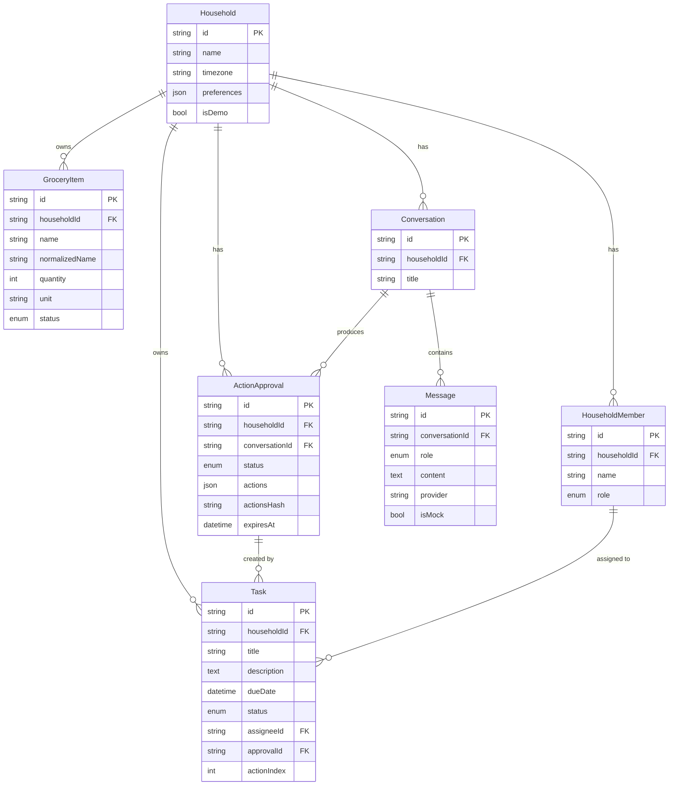

# Database design

MySQL 8.x (tested here against MariaDB 10.11, see README) managed with Prisma 7. Schema: `packages/database/prisma/schema.prisma`. Migration: `packages/database/prisma/migrations/20261013000000_init/migration.sql`.

## Key decisions

- **Enums:** `TaskStatus` (TODO, IN_PROGRESS, DONE, CANCELLED), `GroceryStatus` (NEEDED, PURCHASED), `ApprovalStatus` (PENDING, APPROVED, REJECTED, EXPIRED, EXECUTED, FAILED), `MessageRole`, `MemberRole`.
- **No duplicate groceries:** unique `(householdId, normalizedName)`; the service upserts and _sets_ values (idempotent).
- **Idempotent task creation:** unique `(approvalId, actionIndex)`. MySQL allows many NULLs, so manually created tasks are unaffected.
- **Approval integrity:** `actions` (JSON) plus `actionsHash` (SHA-256 of canonical JSON). The MCP tool re-validates both.
- **Indexes:** `(householdId, status)` and `(householdId, dueDate)` on tasks, `(householdId, status)` on groceries, `(status, expiresAt)` on approvals, `(conversationId, createdAt)` on messages.
- **Deletes:** household deletion cascades; deleting an approval/member nulls the task reference.
- **Validation:** length limits at the database level mirror the Zod limits (`LIMITS` in `packages/shared`).
- **Timestamps:** `createdAt`/`updatedAt` on every mutable table; stored as UTC `DATETIME(3)`.

## Seed data (FAKE)

`npm run db:seed` creates household `demo-household` ("Demo Family (fake data)", `isDemo = true`), three members, four tasks and three grocery items. It is idempotent (fixed ids, upserts).

## Migration strategy

- Development: `npm run db:migrate` (`prisma migrate dev`) creates/applies migrations and needs permission to create a shadow database.
- CI/production: `npm run db:migrate:deploy` applies committed migrations only.
- Tests: `tests/support/globalSetup.ts` rebuilds `homeflow_test` by executing the committed `migration.sql` files in order (so tests do not depend on Prisma's schema engine).
- **Caveat:** the initial `migration.sql` was written by hand in Prisma's MySQL style because Prisma's schema engine could not be downloaded in the authoring sandbox. If `prisma migrate dev` reports drift on your machine, run `npx prisma migrate diff --from-empty --to-schema prisma/schema.prisma --script` inside `packages/database` and replace the file with its output (and re-run tests).
- Optional SQLite fallback is **not** implemented; keep MySQL via `docker-compose.yml`.
